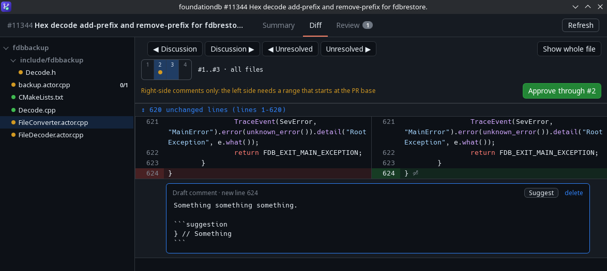
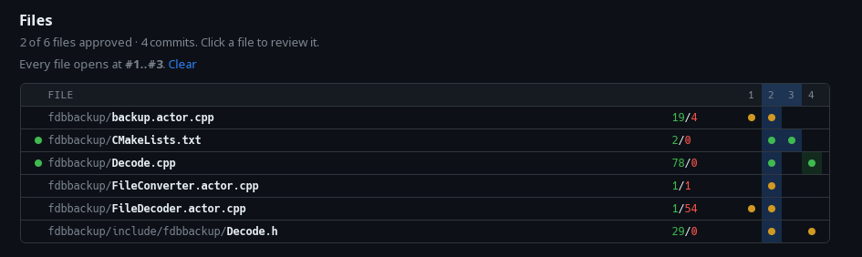
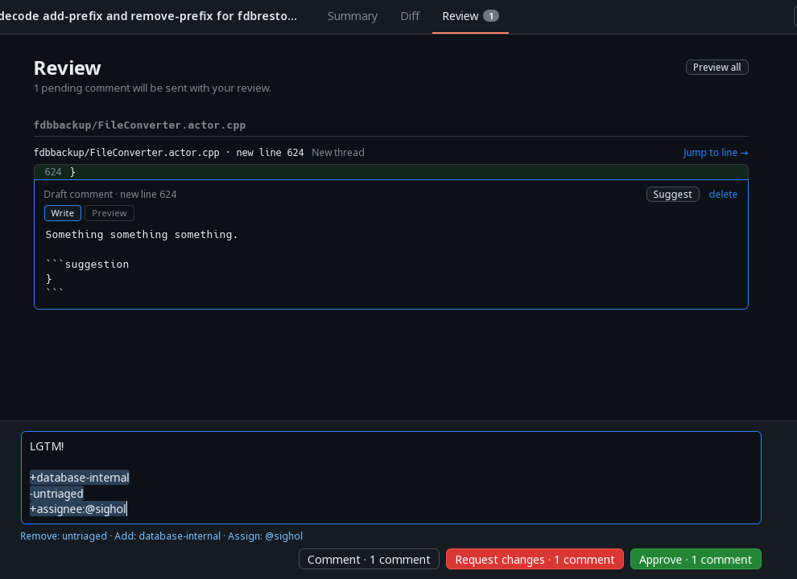

# PR Review

This is a vibe coded experimental code review tool that I made in an evening being frustrated with GitHub.

It is probably too tailored to my own taste to be useful for anyone else. I haven't even read the code.

## Features

#### Individual discussion "resolved" state


The state is stored in a local sqlite database. If a new comment is added to resolved discussion, the discussion will be marked as unresolved, and it will point out what is new.

#### Diff



Comments made on outdated diff lines are more easily discovered than on GitHub.

#### File matrix


File Matrix, showing commits as columns and files as rows. Making it easy to jump around between the diff versions.

#### Review page



Every comment is a draft until it is published. Review page showing all pending comments. The comments can be reviewed, edited, and then finally published here.

The review comment supports directives to add/remove labels and assignees.

#### Other

- In the diff view, highlight changed words.

## Installation

On nixos, I run `nix develop --command just install`.

On other linux OSes, you probably need to first install [tauri](https://tauri.app/).
Then compile it with `cargo tauri build`,
And then copy the `target/release/pr-review` binary to a folder in `$PATH`.

## Usage

```
Review a GitHub pull request side-by-side. Needs `git` and an authenticated `gh`

Usage: pr-review [OPTIONS] <NUMBER>

Arguments:
  <NUMBER>  PR number (a leading # is ignored)

Options:
  -C, --repository <PATH>  Repository to review, defaults to the current directory (like git's -C)
  -w, --wait               Stay in the foreground until the window is closed
  -v, --verbose            Log at info level, including every git and gh call, to stderr (implies --wait)
```

### Environment variables

- `PR_REVIEW_EDITOR`: The editor used when selecting `open in editor` in the file tree.
- `PR_REVIEW_LOG`: What to log. By default, it only logs warnings.
